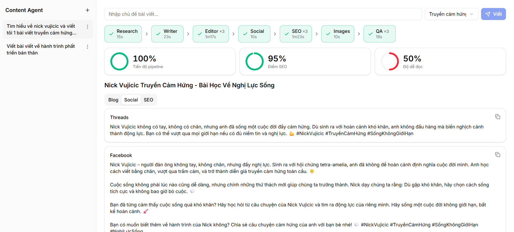

# AI Content Agent

Pipeline nhiều agent (CrewAI) tự động sản xuất blog + bài social từ một từ khoá, có MCP server và dashboard để duyệt.
Tài liệu: [docs/PLAN.md](docs/PLAN.md) · [docs/SPEC.md](docs/SPEC.md) · [docs/LLM_PRICING.md](docs/LLM_PRICING.md) · [tiến độ](docs/progress/README.md)



```
Researcher → Writer → Editor → ┬ Social ┬→ QA ─(≤2 vòng sửa)→ chờ duyệt → duyệt → lịch đăng
                               ├ SEO    ┤
                               └ Images ┘
```

## Chạy lần đầu

```powershell
# 1. Backend (Python 3.12)
cd backend
python -m venv .venv
.venv\Scripts\python -m pip install -e ".[dev]"
copy ..\.env.example ..\.env      # điền OPENROUTER_API_KEY

# 2. Frontend (Node 22, pnpm)
cd ..\frontend
pnpm install
```

## Chạy hằng ngày

```powershell
# Terminal 1 — API + MCP HTTP, cổng 8787
cd backend; .venv\Scripts\content-api

# Terminal 2 — Dashboard, http://localhost:3000
cd frontend; pnpm dev
```

## MCP

16 tool, 5 resource, 2 prompt. Hướng dẫn kết nối Claude Desktop / Claude Code nằm ở trang **Cài đặt & MCP** của dashboard. Nhanh:

```powershell
claude mcp add ai-content-agent -- "<đường dẫn dự án>\backend\.venv\Scripts\content-mcp.exe"
```

Thử bằng MCP client thật: `backend\.venv\Scripts\python backend\scripts\mcp_check.py stdio`

## Kiểm thử và đánh giá

```powershell
cd backend
.venv\Scripts\python -m pytest -q                                        # 17 test, LLM giả, không tốn tiền
.venv\Scripts\python scripts\run_one.py "chủ đề" vi                      # 1 bài thật (~$0.005)
.venv\Scripts\python ..\eval\benchmark.py --variant full --limit 10      # benchmark -> trang Đánh giá
```

Biến thể ablation: `full`, `no_editor`, `no_qa_loop`, `sequential`.

## Cấu hình `.env`

| Biến | Ý nghĩa |
|---|---|
| `OPENROUTER_API_KEY` | Key OpenRouter |
| `MODEL`, `PROVIDER` | Model (tiền tố `openrouter/`) và provider cố định để benchmark nhất quán |
| `PORT` | Cổng backend, mặc định 8787 (8000 hay bị WSL chiếm) |
| `SERPER_API_KEY` | Tuỳ chọn. Trống thì tìm web bằng DuckDuckGo |
| `MCP_TOKEN` | Tuỳ chọn. Có thì MCP HTTP yêu cầu `Authorization: Bearer ...` |
| `PRICE_IN`, `PRICE_OUT` | $/1M token để tính chi phí (mặc định qwen3-14b @ DeepInfra) |
