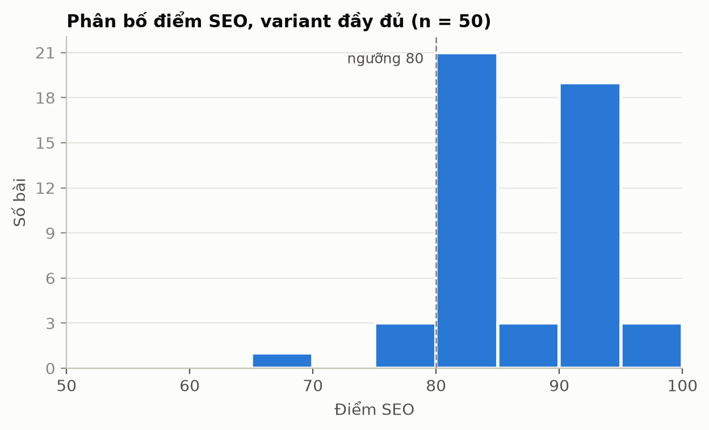
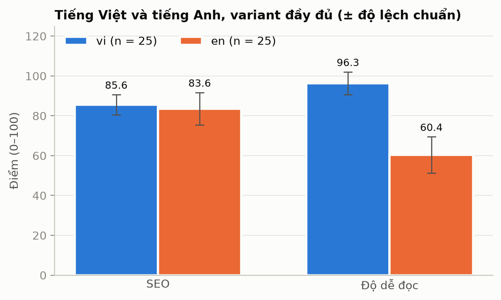
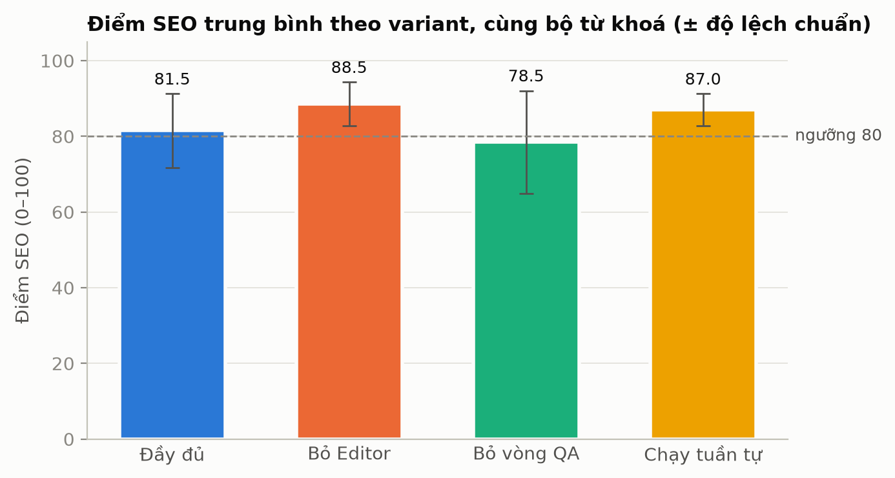
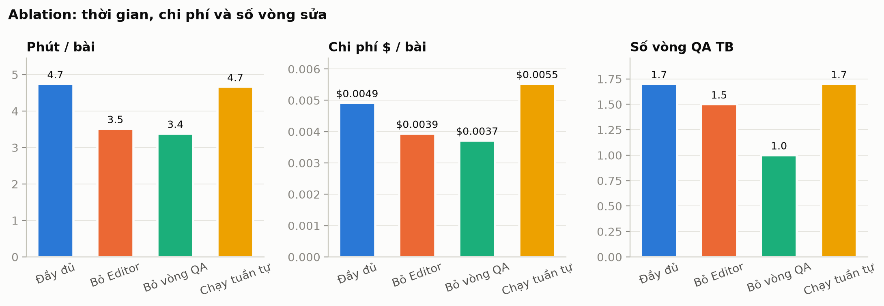
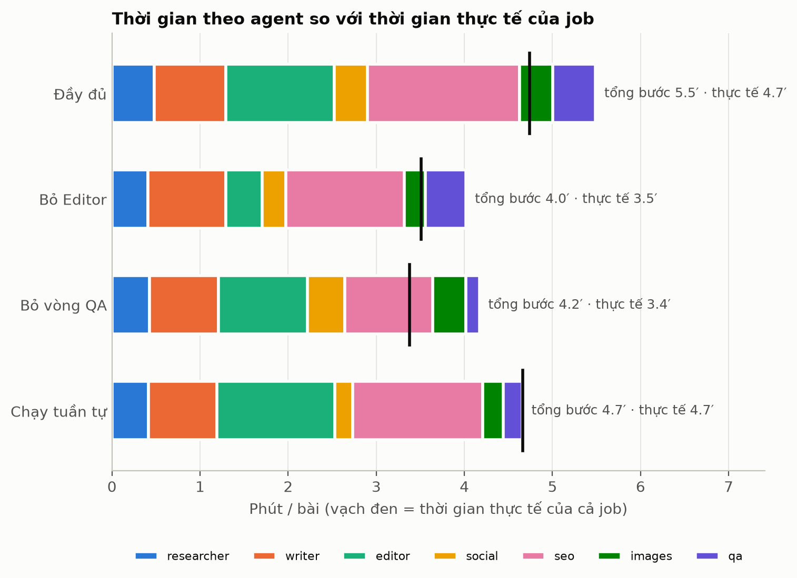

# Báo cáo benchmark

Chạy ngày 01/11/2026. Số liệu thô nằm trong bảng `BenchmarkRun` của `data.db`. Bảng và chart tạo lại bằng `eval/report.py` (mục 9). Ảnh nằm trong [img/](img/).

## 1. Tóm tắt

- Chạy 80 bài, không bài nào lỗi, tổng chi phí khoảng $0.36: variant đầy đủ (`full`) 50 bài và ba variant ablation, mỗi variant 10 bài.
- **Variant đầy đủ đạt mục tiêu**: SEO 84.6 (mục tiêu ≥ 80), độ dễ đọc 78.3 (mục tiêu ≥ 60), 3.8 phút/bài (mục tiêu < 10 phút), $0.0045/bài. 84% bài đạt cả hai ngưỡng.
- **Tiếng Việt đạt hết, tiếng Anh còn yếu**: tiếng Việt 25/25 bài đạt cả hai ngưỡng; tiếng Anh 17/25. Điểm tiếng Anh thấp là do **từ dài** (1.55 âm tiết/từ), không phải do câu dài (mục 6).
- **Điểm SEO bị chặn trần vì từ khoá bị lặp quá nhiều** (trung bình 13–14 lần/bài so với khoảng 4 lần mà pipeline nhắm tới). Đây là vấn đề chưa sửa, mục 6.3.
- Kết quả ablation chưa đủ mẫu để kết luận chắc, trừ việc vòng QA có ích cho SEO (mục 4).

## 2. Thiết lập

| Mục | Giá trị |
|---|---|
| Model | `qwen/qwen3-14b` qua OpenRouter, cố định provider DeepInfra (`allow_fallbacks: false`) |
| Bộ từ khoá | 50 chủ đề (25 tiếng Việt, 25 tiếng Anh), đa lĩnh vực: sức khoẻ, tài chính, du lịch, công nghệ, kinh doanh nhỏ, giáo dục. File `eval/keywords.json` |
| `full` | 50 bài, chạy thành 3 đợt (20 + 16 + 14 từ khoá) |
| Ablation | `no_editor`, `no_qa_loop`, `sequential`: mỗi variant 10 bài, cùng 10 từ khoá đầu (5 vi + 5 en) |
| Chấm điểm | SEO 100 điểm (12 tiêu chí, bên dưới); độ dễ đọc 0–100; **đạt** khi SEO ≥ 80 và dễ đọc ≥ 60 |

Tiêu chí SEO (mỗi mục đạt thì được đủ điểm, code ở `backend/src/content_agent/scoring/seo.py`):
10 điểm mỗi mục: từ khoá trong H1; từ khoá trong 100 từ đầu; từ khoá trong ít nhất 1 H2; mật độ từ khoá 0.5–2.5%; meta description 120–160 ký tự có từ khoá; độ dài ≥ 1200 từ; ít nhất 3 H2; có link nguồn ngoài.
5 điểm mỗi mục: meta title ≤ 60 ký tự; slug ngắn, có từ khoá, không dấu; image prompt có alt text; độ dễ đọc đạt ngưỡng.

Các variant:
- **full**: Researcher → Writer → Editor → (Social ∥ SEO ∥ Images) → QA, vòng sửa QA tối đa 2 lần.
- **no_editor**: bỏ lượt Editor đầu tiên. Editor vẫn được gọi trong các vòng sửa của QA.
- **no_qa_loop**: chấm QA nhưng không sửa lại.
- **sequential**: Social, SEO, Images chạy lần lượt thay vì song song.

## 3. Kết quả chính (variant `full`, 50 bài)

| Chỉ số | Mục tiêu | Kết quả |
|---|---|---|
| SEO trung bình | ≥ 80 | **84.6 ± 6.8** (92% bài ≥ 80) |
| Dễ đọc trung bình | ≥ 60 | **78.3** |
| Đạt cả hai ngưỡng | | 84% (42/50) |
| Thời gian | < 10 phút/bài | 3.8 phút (xem hạn chế, mục 7) |
| Chi phí | báo cáo | $0.0045/bài (ước lượng) |
| Số từ trung bình | ≥ 1200 | 1602 |
| Vòng QA trung bình | | 1.5 |



### Tiếng Việt và tiếng Anh

| Ngôn ngữ | n | SEO | SEO ≥ 80 | Dễ đọc | Dễ đọc ≥ 60 | Đạt cả hai | Vòng QA | Phút/bài | $/bài |
|---|---|---|---|---|---|---|---|---|---|
| Tiếng Việt | 25 | 85.6 ± 5.1 | 100% | 96.3 | 100% | 25/25 | 1.1 | 3.2 | 0.0039 |
| Tiếng Anh | 25 | 83.6 ± 8.1 | 84% | 60.4 | 68% (17/25) | 17/25 | 1.9 | 4.3 | 0.0051 |



Tiếng Anh cần gần gấp đôi số vòng QA và vẫn kém hơn. Hai điểm dễ đọc **không so trực tiếp được** vì dùng hai công thức khác nhau (mục 6.1).

## 4. Ablation (cùng 10 từ khoá)

| Variant | SEO TB ± std | SEO ≥ 80 | Dễ đọc | Phút/bài | $/bài | Vòng QA |
|---|---|---|---|---|---|---|
| Đầy đủ | 81.5 ± 9.7 | 70% | 79.7 | 4.7 | 0.0049 | 1.7 |
| Bỏ Editor | 88.5 ± 5.8 | 100% | 79.9 | 3.5 | 0.0039 | 1.5 |
| Bỏ vòng QA | 78.5 ± 13.6 | 60% | 79.3 | 3.4 | 0.0037 | 1.0 |
| Chạy tuần tự | 87.0 ± 4.2 | 100% | 75.2 | 4.7 | 0.0055 | 1.7 |







Nhận xét, kèm mức chắc chắn:
- **Vòng QA có ích cho SEO.** Bỏ vòng QA cho SEO thấp nhất (78.5) và tỉ lệ đạt thấp nhất (60%). Đây là kết quả nhất quán nhất, dù n = 10 nên khoảng tin cậy rộng (std 13.6).
- **Chưa chứng minh được lợi ích của Editor đầu.** `no_editor` (88.5) cao hơn `full` (81.5) trên cùng 10 từ khoá. Với std 6–10 và n = 10, chênh 7 điểm chưa đủ để nói Editor có hại; chỉ có thể nói chưa thấy lợi ích. Cần thêm bài để trả lời.
- **Chạy song song tiết kiệm khoảng 0.8 phút/bài ở biểu đồ theo agent** (tổng các bước 5.5 phút, thực tế 4.7 phút), còn ở `sequential` hai con số bằng nhau (4.7). Nhưng cột "phút/bài" của `full` và `sequential` đều là 4.7 vì `full` chạy dưới tải nặng hơn (mục 7), nên không dùng cột này để so hai variant.
- Chi phí chênh ít giữa các variant ($0.0037–$0.0055), chủ yếu theo số vòng QA.

## 5. Vấn đề gặp phải và cách xử lý

### 5.1 SEO và độ dễ đọc thấp ở các bài đầu (30/10)

Bốn bài thử đầu có SEO 45–95 và độ dễ đọc 50–79 (thang cũ). Phân tích ra 5 nguyên nhân:

| Nguyên nhân | Cách xử lý |
|---|---|
| **Vòng sửa QA không sửa được gì.** Ghi chú gửi Editor chỉ có tên mục trượt, không có từ khoá hay câu cần sửa; prompt Editor lại dặn "giữ mọi heading". Bằng chứng: Editor trả đúng cùng số token ở các vòng (2264 → 2264), tức là chép lại. | QA sinh **lệnh sửa cụ thể**: nêu nguyên văn từ khoá cần đưa vào H1/câu đầu/H2, số lần cần dùng, danh sách câu dài cần tách. Lệnh đặt đầu prompt Editor, Editor được sửa heading. Thêm **dừng sớm** khi một vòng sửa không làm tăng điểm nào. |
| **Từ khoá chính dài, cứng, so khớp nguyên cụm.** Từ khoá "lịch sử hình thành ESP32", H1 viết "…của ESP32" → trượt 4 mục, SEO 45. | Researcher chạy 2 bước: tách chủ đề khỏi câu lệnh, chọn từ khoá 2–4 từ đọc tự nhiên được trong câu và heading. Writer bắt buộc dùng nguyên cụm trong H1, câu đầu và một H2. |
| **Chủ đề nhập dạng câu lệnh** ("tìm hiểu về… và viết tôi bài…") bị dùng nguyên văn làm truy vấn search và H1. | Cùng bước 1 của Researcher: tách `subject` và sinh `search_query` riêng. |
| **Giọng "truyền cảm hứng" kéo dài câu** (26–27 âm tiết/câu). | Prompt Writer: "giọng văn đổi cách dùng từ, không đổi độ dài câu". |
| **Thang dễ đọc tiếng Việt quá khắt khe.** Công thức đếm **âm tiết** (khoảng 1.4 âm tiết/từ thật) nhưng ngưỡng 20 "từ"/câu lấy từ tiếng Anh, nên câu 26 âm tiết (~18 từ thật, bình thường) bị trừ 24 điểm. | Thang tiếng Việt tính theo âm tiết: câu trung bình ≤ 22, câu dài > 40 âm tiết. Chấm lại 4 bài cũ bằng thang mới: 78.8 → 89.8, 49.9 → 64.4, 50.4 → 73.7, 63.2 → 80.2. |

Chạy lại hai chủ đề cũ sau khi sửa: SEO 45 → 80 và 70 → 80, dễ đọc 99–100.

### 5.2 Bài mất link nguồn

Bài ESP32 có 3 nguồn từ search nhưng blog cuối có 0 link: Writer, Editor và SEO làm rơi link khi viết lại. **Đã sửa:** khi trượt mục link, lệnh sửa QA liệt kê sẵn các nguồn `[tiêu đề](url)` để Editor chèn; không có nguồn thì không yêu cầu (tránh bịa link).

**Còn mở:** DuckDuckGo thỉnh thoảng trả về rỗng. Trong benchmark có 9/25 bài tiếng Việt và 6/25 bài tiếng Anh không có nguồn nào, và mục "link nguồn" trượt ở 12 + 8 bài. Nên dùng `SERPER_API_KEY`.

### 5.3 Độ dễ đọc tiếng Anh thấp: 29.4 → 60.4

- **Hiện tượng:** bài tiếng Anh thử đầu tiên ("remote work productivity tips") có SEO 85 nhưng dễ đọc **29.4**. Tiếng Anh dùng Flesch Reading Ease (ngưỡng 60).
- **Nguyên nhân gốc ở prompt:** Writer chỉ được dặn "câu trung bình < 20 từ, tối đa 30 từ". Mức này cho Flesch khoảng 30–40. Editor chỉ tách câu > 30 từ, và danh sách câu cần sửa chỉ nêu câu > 35 từ. Bước SEO chèn từ khoá làm câu dài thêm.

| Sửa | Chi tiết |
|---|---|
| Luật câu theo ngôn ngữ (`SENTENCE` trong `steps.py`) | Tiếng Anh: trung bình < 15 từ, tối đa 22 từ, dùng từ ngắn ("use" thay "utilize"), tối đa 3 câu/đoạn. Tiếng Việt giữ như cũ. Dùng cho Writer và ngưỡng tách câu của Editor. |
| Prompt SEO | "Không làm câu dài hơn khi chèn từ khoá, viết lại câu cho ngắn." |
| Ngưỡng "câu dài" tiếng Anh | 35 → 25 từ; lệnh sửa QA nhắc mục tiêu khoảng 15 từ/câu. |
| Meta description | Quá 160 ký tự thì cắt bằng code ở ranh giới từ, không gọi lại LLM. |

- **Kết quả:** chạy lại 4 bài tiếng Anh: dễ đọc trung bình 64.3 (bài "remote work productivity tips" 29.4 → 57.8). Benchmark đầy đủ: tiếng Anh 60.4.
- **Chưa xong:** vẫn sát ngưỡng, 8/25 bài tiếng Anh còn dưới 60. Nguyên nhân còn lại không phải độ dài câu (mục 6.2). "Trước" chỉ so được trên 1 bài.

### 5.4 Vấn đề khi chạy benchmark

| Vấn đề | Xử lý |
|---|---|
| Chạy 80 bài lần lượt ước tính mất khoảng 4 giờ, vượt giới hạn 2 giờ | Thêm `--concurrency N` (chạy N bài song song) và chạy 4 variant cùng lúc. Cái giá: DeepInfra trả 429 (`engine_overloaded`) nhiều lần, hệ thống tự thử lại, không bài nào lỗi nhưng thời gian đo bị cao hơn (mục 7). |
| Bộ từ khoá chỉ có 20 mục | Mở rộng lên 50, thêm `--skip N` để chạy phần chưa dùng; `report.py` gộp các lần chạy cùng variant (`full-extra*`), bỏ lần chạy thử. |
| `full` có 50 bài, ablation chỉ 10 bài, so thẳng là lệch | `report.py` so ablation trên đúng 10 từ khoá chung. |
| Chạy tay `benchmark.py` từ thư mục gốc repo lỗi vì `.venv` nằm trong `backend/`; chạy tay trùng lần chạy nền làm 2 run chạy cùng lúc | Dừng lần chạy trùng, chạy lại một lần. |
| Dừng giữa chừng để lại vài job ở trạng thái `running` trong DB | Chưa dọn. Không ảnh hưởng số liệu (kết quả chỉ lưu khi cả variant xong). |

## 6. Phân tích: vì sao điểm dễ đọc khác nhau giữa hai ngôn ngữ, và vấn đề của model

Đo trực tiếp trên 50 bài `full`:

| | Tiếng Việt (25 bài) | Tiếng Anh (25 bài) |
|---|---|---|
| Điểm dễ đọc | 96.3 | 60.4 |
| Độ dài câu trung bình | 20.1 âm tiết (khoảng 14 từ thật) | 11.5 từ |
| Câu/đoạn | 3.7 | 4.4 |
| Câu dài (vượt ngưỡng) | 0.7% | 0.7% |
| Số âm tiết/từ | không đo | **1.55** |

### 6.1 Câu hỏi "tiếng Việt thấp hơn tiếng Anh" thì dữ liệu cho thấy ngược lại

Điểm tiếng Việt **cao hơn** nhiều (96.3 so với 60.4). Có hai lý do cần tách bạch:
- **Hai thang điểm khác nhau.** Tiếng Anh dùng Flesch (206.835 − 1.015 × từ/câu − 84.6 × âm tiết/từ), có đo độ dài từ. Tiếng Việt dùng thang tự định nghĩa: 100 trừ phạt khi câu trung bình > 22 âm tiết, khi đoạn có > 4 câu, và khi có nhiều câu > 40 âm tiết. Các bài đạt 20.1 âm tiết/câu, 3.7 câu/đoạn, 0.7% câu dài nên gần như không bị trừ điểm.
- **Thang tiếng Việt chỉ đo độ dài câu và đoạn**, không đo độ khó của từ (từ Hán Việt, thuật ngữ). Nó dễ cho điểm cao và **chưa được kiểm chứng** bằng người đọc. Vì vậy 96.3 không có nghĩa tiếng Việt "dễ đọc gấp rưỡi" tiếng Anh. Muốn khẳng định cần human rating.

Điểm tiếng Việt thấp ở các bài đầu (49.9–63.2) là do lỗi thang điểm, đã sửa ở mục 5.1.

### 6.2 Vấn đề với model ở tiếng Anh: từ dài, không phải câu dài

Câu tiếng Anh trung bình chỉ **11.5 từ**, đã ngắn. Phần kéo Flesch xuống là **1.55 âm tiết/từ**: với công thức trên, mỗi 0.1 âm tiết/từ làm điểm lệch khoảng 8.5, còn rút một từ khỏi câu chỉ được khoảng 1 điểm. Prompt đã dặn dùng từ ngắn và câu ngắn, kết quả cải thiện từ 29.4 lên 60.4 nhưng dừng lại sát ngưỡng. Kết luận có thể rút ra:
- Model `qwen3-14b` **nghe lời về độ dài câu nhưng ít nghe lời về chọn từ**: câu đã ngắn mà từ vẫn dài và trang trọng.
- Tiếp tục ép câu ngắn hơn sẽ không giúp thêm. Cần can thiệp ở **chọn từ**: danh sách từ cần tránh/thay, hoặc bước Editor riêng "thay từ dài bằng từ đơn giản", hoặc thử model lớn hơn.
- Danh sách câu dài gửi cho Editor ở vòng QA (`long_examples`) chỉ nêu câu, không nêu từ khó, nên Editor không biết sửa từ nào. Đây là chỗ nên đổi.

### 6.3 Vấn đề của model ở SEO: lặp từ khoá quá nhiều

Tiêu chí **mật độ từ khoá** (0.5–2.5%) là mục trượt nhiều nhất: **21/25 bài tiếng Việt và 19/25 bài tiếng Anh**. Mật độ trung bình là 5.2% (vi) và 3.6% (en), tức là vượt trần chứ không phải thiếu.
- Từ khoá xuất hiện trung bình **14 lần (vi) và 13 lần (en)** mỗi bài. Prompt Writer yêu cầu khoảng 6–9 lần, còn lệnh sửa của QA nhắm khoảng 4–5 lần (`pipeline._fixes`, tính theo mật độ 1.5%). Từ khoá tiếng Việt dài trung bình 6 âm tiết nên mỗi lần lặp đóng góp nhiều vào mật độ.
- Nhiều khả năng bước SEO và Editor, vốn được dặn "giữ từ khoá nguyên cụm ở mọi chỗ nó xuất hiện" và "đưa từ khoá vào H1, 100 từ đầu, H2", đã nhồi thêm từ khoá. Mình chưa kiểm tra từng bước nên đây là suy luận.
- **Hậu quả:** mất 10 điểm ở hầu hết bài, nên SEO tiếng Việt chỉ ra hai mức 80 hoặc 90. Vòng QA không sửa vì bài đã ≥ 80 nên được coi là đạt.
- **Nên làm:** hạ số lần dùng từ khoá trong prompt Writer và SEO, hoặc đưa cảnh báo mật độ vào vòng QA ngay cả khi SEO ≥ 80. Việc này chưa làm vì ngoài phạm vi đợt benchmark.

## 7. Hạn chế

- **Mẫu nhỏ.** Mỗi variant ablation chỉ 10 bài; chênh vài điểm nằm trong nhiễu.
- **Thời gian bị đo dưới tải.** Để chạy xong trong 2 giờ, 4 variant chạy cùng lúc (khoảng 12 bài song song) và DeepInfra giới hạn tốc độ. Cột "phút/bài" cao hơn thời gian thực khi chạy một bài (lần thử riêng trước đó: 80–190 giây/bài). Chỉ nên dùng để so thô.
- **Chi phí là ước lượng.** CrewAI không đếm được token chính xác của `qwen/qwen3-14b`, nên token đầu vào và chi phí là xấp xỉ.
- **Điều kiện chạy khác nhau giữa các variant**: `full` chạy 3 bài song song theo từng đợt, ablation chạy 2 bài song song.
- **Điểm là điểm máy chấm.** Chưa có human rating (5 người, mục tiêu ≥ 4/5) và chưa có engagement proxy (LLM-as-judge). Thang tiếng Việt chưa hiệu chỉnh.
- **Chưa so với hệ thống khác.** Chưa tìm thấy benchmark chuẩn nào chấm SEO cho blog tiếng Việt, và số liệu của hệ thống khác dùng thước đo khác nên không so công bằng được.
- **Mọi số liệu chạy sau các sửa đổi ở mục 5.** Các số trước sửa (bài thử đầu) chỉ dùng làm đối chứng trong mục 5, không nằm trong bảng benchmark.

## 8. Việc tiếp theo

1. Giảm số lần lặp từ khoá (mục 6.3) và chạy lại để thấy SEO tăng lên.
2. Thêm bước/prompt chọn từ đơn giản cho tiếng Anh (mục 6.2).
3. Dùng `SERPER_API_KEY` để giảm số bài không có nguồn.
4. Chấm human rating (5 người), nhập bằng `--human-rating`, và dùng kết quả để hiệu chỉnh thang tiếng Việt.
5. Thêm baseline một prompt trên cùng bộ từ khoá và so với model khác qua OpenRouter.
6. Tăng mẫu ablation lên ≥ 20 bài/variant, chạy ít song song hơn để đo thời gian đáng tin.
7. Thêm engagement proxy cho bài social.

## 9. Tái lập

Chạy từ thư mục `backend`, bằng python của venv:

```
.venv\Scripts\python ..\eval\benchmark.py --variant full --limit 20 --concurrency 3
.venv\Scripts\python ..\eval\benchmark.py --variant full --skip 20 --limit 16 --concurrency 3 --name full-extra
.venv\Scripts\python ..\eval\benchmark.py --variant full --skip 36 --limit 14 --concurrency 3 --name full-extra2
.venv\Scripts\python ..\eval\benchmark.py --variant no_editor --limit 10 --concurrency 2
.venv\Scripts\python ..\eval\benchmark.py --variant no_qa_loop --limit 10 --concurrency 2
.venv\Scripts\python ..\eval\benchmark.py --variant sequential --limit 10 --concurrency 2
.venv\Scripts\python ..\eval\report.py       # in bảng markdown, ghi chart vào docs/report/img/
```
